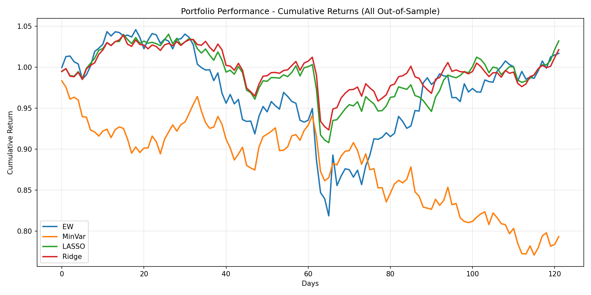
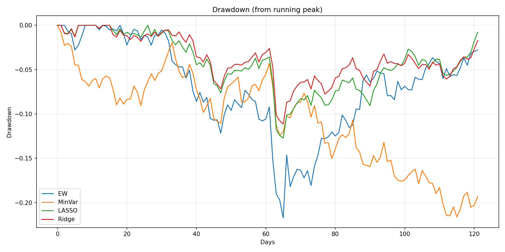
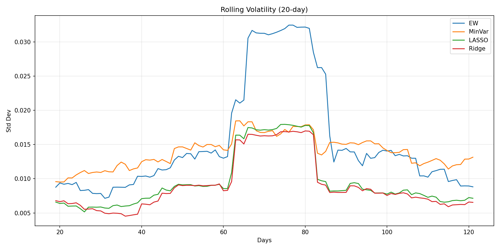
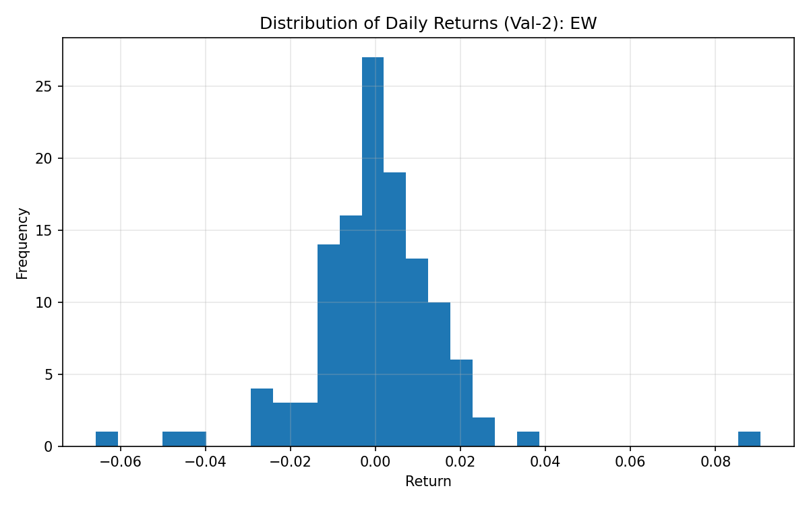
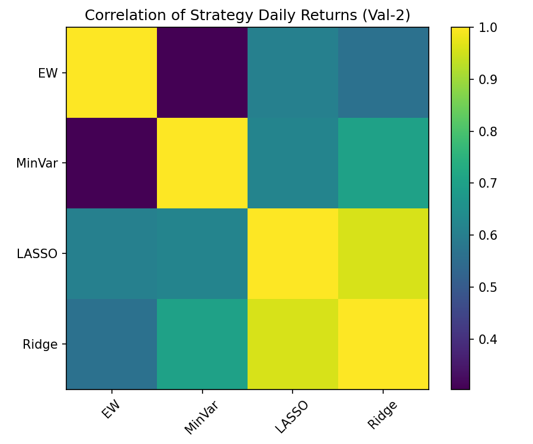

# Regularised Portfolio Optimisation

**Quantitative Finance | Portfolio Construction | Risk Management**

Can regularisation improve portfolio construction when working with a large number of correlated assets?

This project explores different approaches to minimum-variance portfolio optimisation using 100 daily portfolio return series from the [Kenneth R. French Data Library](https://mba.tuck.dartmouth.edu/pages/faculty/ken.french/data_library.html).

The objective is to investigate whether regularisation techniques can produce more stable portfolio weights and improve out-of-sample performance compared with traditional minimum-variance optimisation.

## What I Explored

- **Equal-Weight Portfolio:** A simple benchmark allocating equally across all 100 portfolios.
- **Minimum-Variance Optimisation:** A traditional approach to minimising portfolio risk.
- **LASSO Regression:** Uses regularisation to encourage sparse portfolio weights.
- **Ridge Regression:** Applies regularisation to reduce sensitivity to noisy estimates.

The minimum-variance problem is reformulated as a regression problem, allowing LASSO and Ridge regularisation to be applied.

## Results

The notebook's recorded validation results showed that LASSO and Ridge performed better than the equal-weight and unregularised minimum-variance benchmarks over the evaluated period.

| Strategy | Daily Volatility | Cumulative Return |
|---|---:|---:|
| Equal Weight | 1.7544% | -3.03% |
| Minimum Variance | 1.3835% | -18.96% |
| LASSO | 1.1153% | +2.68% |
| Ridge | 0.9963% | +2.28% |

*Note: These are recorded notebook outputs, not independently verified results. The saved CSV and figures have not yet been reconciled with the notebook summary. The evaluation covers January–June 2025 and should not be interpreted as evidence of long-term investment performance.*

## Visualisations

**Portfolio Performance**



**Portfolio Drawdowns**



**Rolling 20-Day Volatility**



**Return Distribution**



**Validation-2 Strategy Return Correlations**



## Dataset

- Source: [Kenneth R. French Data Library](https://mba.tuck.dartmouth.edu/pages/faculty/ken.french/data_library.html)
- Dataset: 100 Portfolios Formed on Size and Operating Profitability
- Frequency: Daily returns
- Coverage: July 1963 – June 2025

The equal-weight benchmark is calculated directly from the 100 portfolio return series.

## Repository Structure

```text
├── final_test_daily.ipynb
├── cleaned_equal_weighted_daily.csv
├── portfolio_results.csv
├── figs/
├── legacy_code/
├── pyproject.toml
└── poetry.lock
```

## Getting Started

**Requirements:** Python 3.13+ and Poetry.

```bash
poetry install
poetry run jupyter notebook
```

Open `final_test_daily.ipynb` and run the notebook sequentially from the repository root.

## Limitations

- The evaluation period is relatively short.
- Transaction costs and additional portfolio constraints are not modelled.
- The supplied dataset does not cover the notebook's intended August 2025 final-test period.
- Elastic Net and Group LASSO are potential extensions, not implemented strategies.

*This project is an academic exploration of quantitative portfolio construction and does not constitute investment advice.*